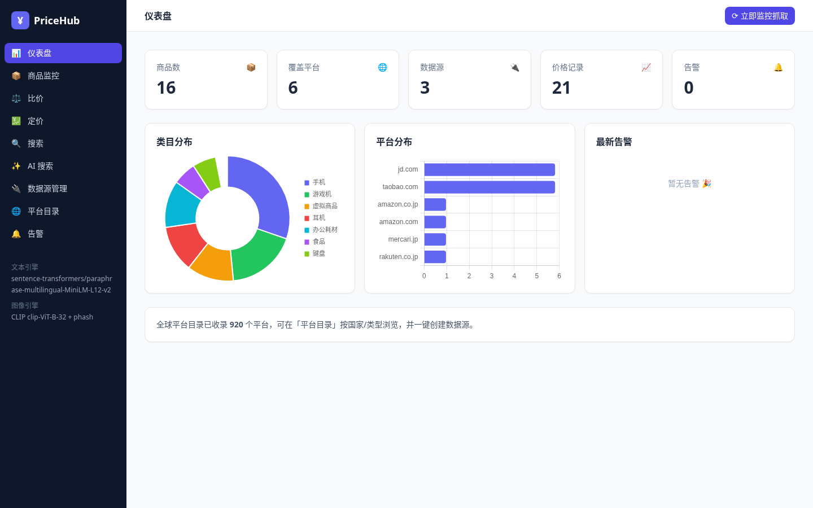
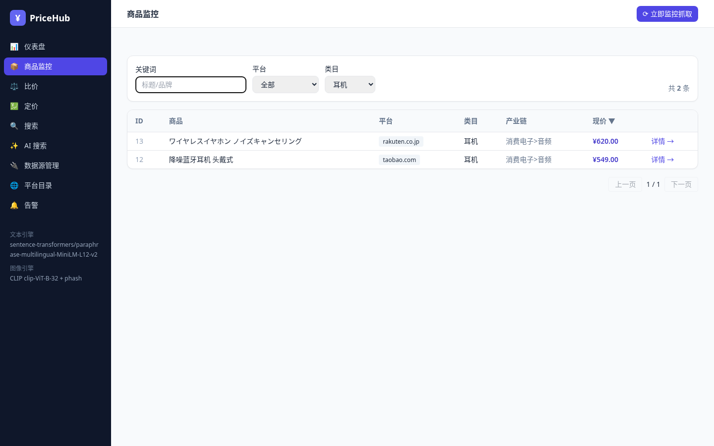
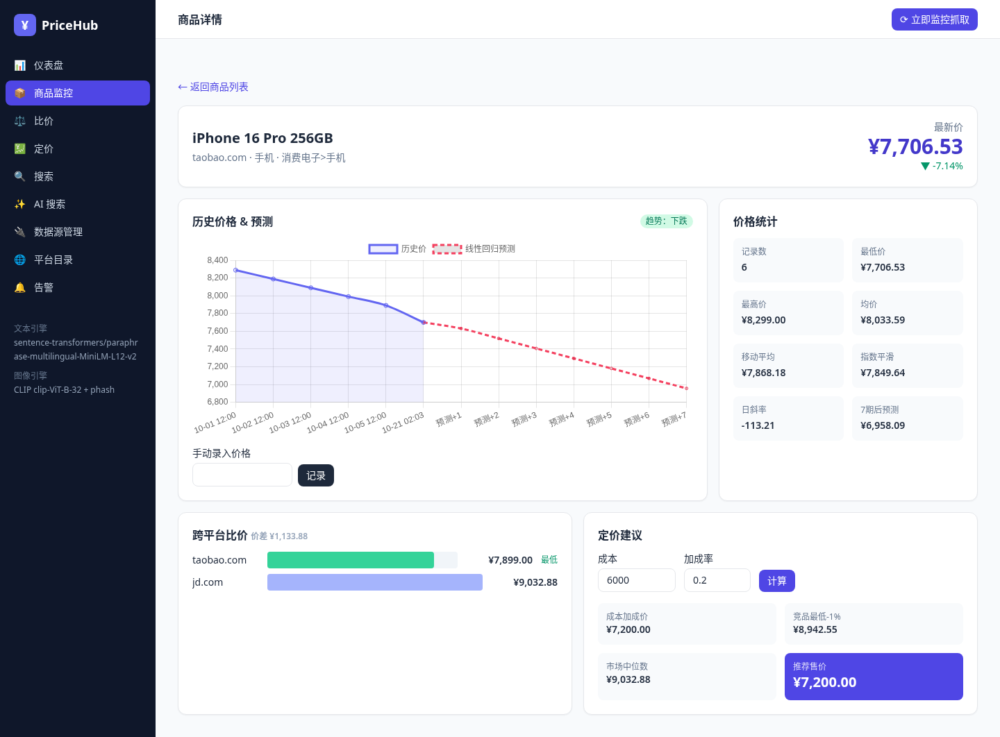

# PriceHub

竞品价格监控与控价：多平台采集、同款匹配与去重、价格告警、定价与买入建议；可在本机桌面或服务器运行。

## 下载

当前 GitHub 上**没有**已发布的 Windows / macOS / Linux 安装包（无 Release）。README 旧文提到本机 `dist/PriceHub` / `PriceHub-linux-x64.tar.gz`，那是本机构建产物，不是 GitHub 发行资产。桌面打包需在目标系统执行 `./build_desktop.sh`（PyInstaller **不能**交叉编译）。本轮因磁盘不足未重新打包上传。

## 界面截图

以下为仓库 `screenshots/` 中已有的真实产品界面，不是生成图。



*仪表盘 / Dashboard*



*产品列表 / Products*



*产品详情 / Product detail*

更多见 `screenshots/`（搜索、数据源、告警、移动端布局等）。

## 从源码运行

```bash
# 示例（本机路径按实际调整）
python -m venv .venv
. .venv/bin/activate
pip install -r requirements.txt
uvicorn app.main:app --port 8800
# UI: http://127.0.0.1:8800/   API docs: /docs
```

桌面窗口（pywebview）：`python desktop.py`（自动起本地服务+窗口），或 `python desktop.py --url http://服务器:8800`。

监控采集指标时，请自行生成 `PRICEHUB_METRICS_TOKEN`，写入未纳入版本库的配置文件（可参考仓库中的 example）。**不要把令牌、密钥写进 README、日志或 PR。**

## 限制

- 无已发布安装包；Windows 需本机打包。
- 依赖外部数据源与可选 AI Key；未配置时相关能力不可用。
- 仓库根目录 LICENSE 情况以仓库实际文件为准；本 PR 不新增 LICENSE。

---

## English

**PriceHub** monitors competitor prices: multi-source crawl, matching/dedup, alerts, and pricing suggestions. Run as a local server or desktop (pywebview) shell.

### Download

No published installer on GitHub Releases. Desktop builds use PyInstaller on the target OS (`./build_desktop.sh`); they cannot be cross-compiled. This pass did not package or upload artifacts (disk).

### Screenshots

The images above are existing real UI captures under `screenshots/`. They are not generated artwork.

### Run from source

```bash
python -m venv .venv
. .venv/bin/activate
pip install -r requirements.txt
uvicorn app.main:app --port 8800
```

Do not commit metrics tokens or API keys.
