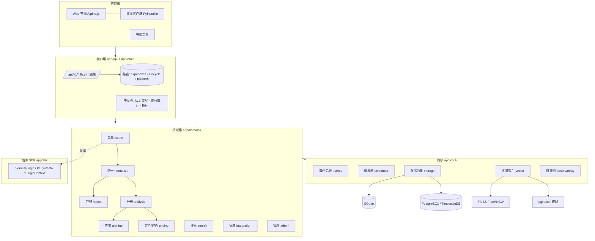
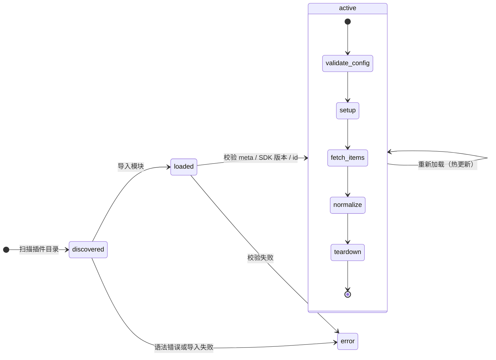
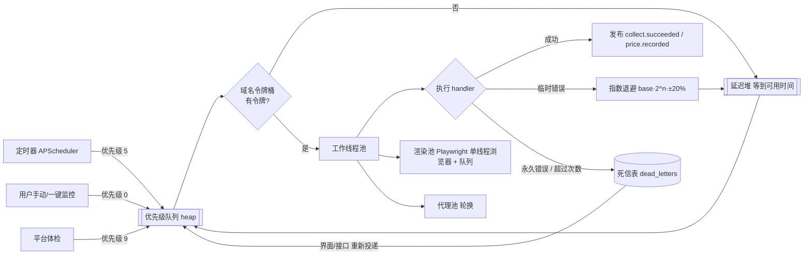
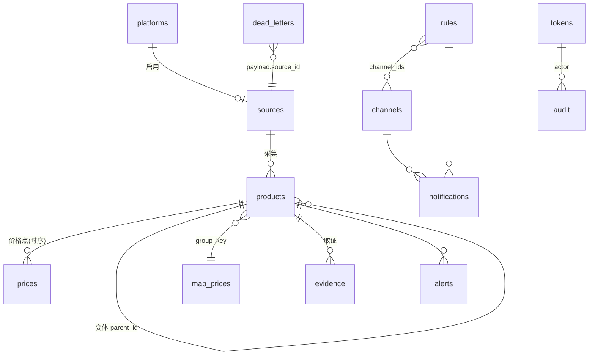
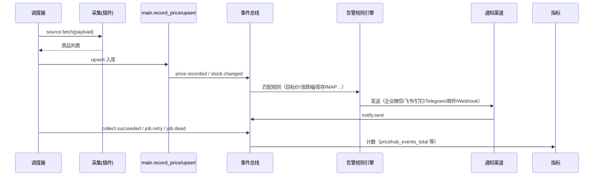
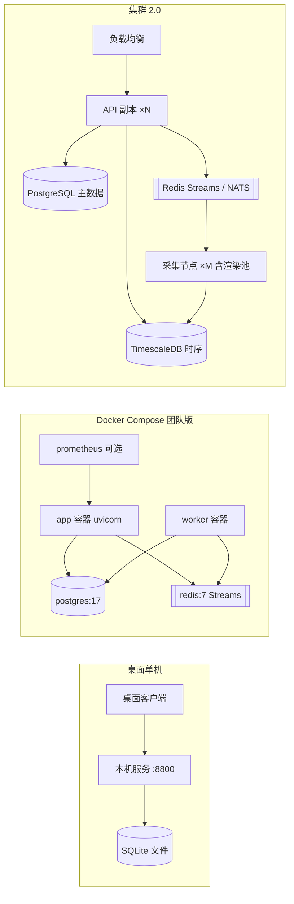

# PriceHub 架构设计

> 版本：v6 ｜ 日期：2026-10-21 ｜ 对应代码：`app/core`、`app/domains`、`app/sdk`、`app/api`

## 1. 设计目标与约束

| 目标 | 说明 |
|---|---|
| 一套代码三种形态 | 桌面单机（SQLite、零依赖）→ Docker Compose 团队版（PostgreSQL）→ 集群（分布式采集节点 + 时序库） |
| 领域清晰、可替换 | 领域之间只通过事件总线和明确的函数接口交互；存储、向量索引、队列都有抽象层，可换实现 |
| 可扩展 | 数据源以插件形式扩展，第三方插件放进目录即可加载，不改核心代码 |
| 可信 | 每个价格点带来源、方法和置信度；采集失败可追溯（重试记录、死信） |
| 合规 | 按域名限速、遵守 robots/服务条款，不做反爬绕过 |
| 可观测 | 结构化日志、Prometheus 指标、存活/就绪检查 |

## 2. 分层与领域划分



| 领域 | 职责 | 代码位置 | 主要对外接口 |
|---|---|---|---|
| 采集 collect | 数据源（内置 + 插件）、网页解析（JSON-LD/微数据/规则）、无头渲染、代理池、平台目录与体检 | `app/domains/collect/*`、`app/sdk` | `sources.make(type, cfg).fetch()`、`pipeline.fetch_parse()` |
| 归一 normalize | 币种汇率、到手价、置信度计算 | `app/domains/normalize` | `to_cny`、`landed`、`confidence.*` |
| 匹配 match | 条码/型号/文本/图片多信号同款匹配、合并与撤销 | `app/domains/match` | `match_suggest`、`match_merge` |
| 分析 analysis | 统计、预测、买入建议、促销日历、季节性、卖家画像 | `app/domains/analysis` | `analytics.*`、`buy_advice` |
| 告警 alerting | 规则引擎（订阅总线）、6 类通知渠道、发送记录 | `app/domains/alerting` | `on_event`、`send` |
| 定价 pricing | 5 种策略、利润模拟、调价推送；MAP、违规、取证 | `app/domains/pricing` | `apply_rule`、`simulate`、`map_violations` |
| 搜索 search | 多语言语义搜索（FAISS）、以图搜图、AI 查询理解 | `app/domains/search` | `semantic.semantic`、`image_search` |
| 集成 integration | API v1、Webhook、报表导出推送、书签、插件 SDK | `app/domains/integration` | `report_data`、`sdk` |
| 管理 admin | 令牌与角色、审计、备份恢复、设置 | `app/domains/admin` | `tokens`、`audit`、`backup` |

**依赖规则**：界面 → 接口 → 领域 → 内核，单向依赖；领域之间不直接调用对方内部函数，跨领域协作通过事件（如“采集完成 → 价格记录 → 告警”）。旧模块路径（`app/db.py`、`app/render.py` 等）保留为兼容垫片，指向新位置的同一模块对象，保证旧代码与测试不受影响。

**v7 完成情况**：告警、定价、匹配、分析建议、集成、采集设置、管理的业务实现已从 `app/api/lifecycle.py` 下沉到 `app/domains/*/service.py`，`lifecycle.py` 只负责注册路由与接线（46 条路由，旧函数名保留别名）。新增 `app/domains/team`（账号、工作区、邀请、OIDC、用量）。

**当前重构程度（如实说明）**：底层模块（存储、采集、解析、渲染、搜索、置信度、分析）已物理迁移到领域包；v5 的告警/定价/匹配/管理业务函数目前仍在 `app/api/lifecycle.py` 中，领域包以延迟导入的门面对外暴露，下一步把实现逐个下沉。

## 3. 数据源插件 SDK

### 3.1 规范

```python
from app.sdk import SourcePlugin, PluginMeta, PluginError, RetryableError
class MyShop(SourcePlugin):
    meta = PluginMeta(id="myshop", name="我的商城", version="1.0.0", sdk="1.0",
                      config_schema={"url": {"type": "string", "required": True, "label": "接口地址"}},
                      rate_limit_rps=1)
    def setup(self, ctx): ...                 # 可选：建立会话、读取令牌
    def fetch_items(self, ctx):               # 必须：返回商品字典列表
        return [{"external_id": "1", "title": "...", "price": 9.9, "currency": "CNY"}]
    def teardown(self, ctx): ...              # 可选：释放资源（无论成功失败都会调用）
    def healthcheck(self): return {"ok": True}
```

- 商品字段：`external_id`、`title`、`price` 必填；可选 `currency/url/category/brand/image_url/platform/in_stock/gtin/model/seller/shipping`。SDK 统一做校验与标准化（价格去千分位转数字、缺省币种、缺省平台名、缺编号时按链接生成）。
- 网络访问走 `ctx.http_get()`：统一代理池、计数；429/5xx 抛 `RetryableError`（调度器退避重试），4xx 抛 `PluginError`（不重试，直接进死信）。
- 版本兼容：`meta.sdk` 主版本必须与平台 SDK 主版本一致，否则拒绝加载。
- 插件 id 不得与内置数据源冲突。

### 3.2 生命周期



- 发现：`PRICEHUB_PLUGINS_DIR`（默认 `./plugins`）下的 `*.py` 或 `子目录/plugin.py`，下划线开头忽略。
- 接口：`GET /api/v1/plugins`（目录与加载报告）、`POST /api/v1/plugins/reload`（热加载）、`POST /api/v1/plugins/{id}/test`（用给定配置试跑）。
- 示例：`plugins/jsonfeed_example/plugin.py`（读取任意 JSON 商品接口）。详细说明见 `docs/PLUGIN_SDK.md`。

## 4. 采集调度



| 机制 | 实现 | 默认值（环境变量） |
|---|---|---|
| 优先级 | 小顶堆，数字越小越先 | 手动 0 / 定时 5 / 体检 9 |
| 限速 | 每域名令牌桶，被限速任务进延迟堆，不占工作线程 | 1 次/秒，突发 3（`PRICEHUB_DOMAIN_RPS`/`_BURST`），可按域名 `PUT /api/v1/scheduler/rate` |
| 重试 | 指数退避 + 抖动，上限 300 秒 | 基数 2 秒（`PRICEHUB_BACKOFF_S`），最多 4 次 |
| 死信 | 持久化到 `dead_letters`，可重投/删除 | `GET /api/v1/deadletters` |
| 并发 | 工作线程池 | 4（`PRICEHUB_WORKERS`） |
| 渲染池 | 单浏览器工作线程 + 任务队列（保证 Playwright 线程安全），直接读取失败时回退 | `PRICEHUB_NO_RENDER=1` 关闭 |
| 代理 | 设置里的代理列表轮换 | 空 = 直连 |

任务只携带可序列化的 `kind + payload`，处理函数按 kind 注册，因此后续可以无改动地替换为 Redis Streams / Celery / Arq 的分布式队列。

## 5. 数据模型与时序存储



- **价格点** `prices(id, product_id, price, ts, confidence, conf_level, conf_basis, method, in_stock)`：只追加，(product_id, id) 复合索引支撑“最新价”和“单品历史”两类主查询。
- **存储抽象** `app/core/storage.py`：统一 `q / ex / ex_many / init`。业务 SQL 用 SQLite 方言书写，PostgreSQL 后端执行前自动翻译（`?`→`%s`、`INSERT OR REPLACE/IGNORE`→`ON CONFLICT`、`datetime('now')`、`LIKE`→`ILIKE`、自增主键→`BIGSERIAL`、插入自动 `RETURNING id`、数值类型统一为 float）。选择方式：设置 `PRICEHUB_DB_URL=postgresql://...` 即切换。
- **演进路线**

| 阶段 | 规模 | 价格点存储 | 向量索引 |
|---|---|---|---|
| 单机 | ≤ 10 万 SKU / ≤ 千万点 | SQLite（WAL） | numpy 精确（< 5 万）/ FAISS HNSW |
| 团队 | ≤ 100 万 SKU / ≤ 1 亿点 | PostgreSQL 17 + 按月分区；或 TimescaleDB hypertable + 压缩 | FAISS HNSW 常驻内存 |
| 集群 | 百万以上 / 十亿点 | TimescaleDB 多节点或 ClickHouse 存时序，PostgreSQL 存主数据；离线分析用 DuckDB 读 Parquet 归档 | pgvector HNSW 或独立向量库 |

## 6. 事件总线



- 主题：`price.recorded`、`stock.changed`、`collect.succeeded|failed`、`notify.sent`、`job.succeeded|retry|dead`、`plugin.<id>.*`。
- 支持通配订阅（`price.*`、`*`）；订阅者异常被隔离并计数，不影响发布方。
- 查看：`GET /api/v1/events`（订阅者、各主题发布数、处理失败数、最近事件）。
- 当前为进程内同步总线；集群形态替换为 Redis Streams / NATS，接口不变。

## 7. API 版本化

- 正式路径：`/api/v1/*`。中间件把 `/api/v1/x` 重写到内部 `/api/x`，所以所有接口自动拥有 v1 路径。
- 旧路径 `/api/*` 继续可用（界面仍在使用），响应头带 `X-API-Legacy-Path` 提示迁移；所有响应带 `X-API-Version: v1`。
- 出现不兼容变更时，新增 `/api/v2` 路由组，v1 至少保留两个小版本。
- OpenAPI 文档：`/docs`。

## 8. 多租户与权限

v7 已实现：

- **工作区上下文**：`app/core/tenancy.py` 用 contextvar 保存当前工作区；身份中间件（`app/api/team.py`）按会话 Cookie / `Authorization: Session` / `X-API-Key` 确定用户、工作区和角色后设置；后台任务提交时把工作区写进任务负载，执行时恢复（内存与 Redis 队列一致）。
- **隔离**：14 张业务表（sources、products、prices、channels、rules、notifications、map_prices、evidence、pricing_rules、tokens、audit、alerts、dead_letters、settings）带 `workspace_id`，唯一键改为含 `workspace_id`。
  - SQLite：用 sqlglot 改写每条 SQL——SELECT/UPDATE/DELETE 追加 `workspace_id = ?` 条件（JOIN 条件放在 ON 上），INSERT 自动补列；改写结果按（SQL, 工作区）缓存。
  - PostgreSQL：启用 `FORCE ROW LEVEL SECURITY`，策略 `ws_isolation` 比较 `current_setting('app.ws')`；每次取连接用 `set_config` 设置工作区，`workspace_id` 默认值取自同一设置；系统任务用 `app.bypass` 绕过。
- **账号**：users / memberships / sessions / invites 为全局表；密码 scrypt 哈希；会话只存令牌哈希。OIDC 走授权码流程，校验 state、nonce、签名（JWKS，RS256/ES256）、aud、iss。
- **角色**：owner > admin > editor > viewer；viewer 拒绝所有写方法，editor 拒绝成员/设置类接口；单机模式下本机视为 owner。
- **配额与计量**：`app/domains/team/usage.py`，指标 skus（实时计数）、collects（按月）、api_calls（按天）；计数先在内存累加，每 5 秒写入 usage 表；超限：新增商品和接口调用返回 429，采集任务以永久错误进入死信。

## 8.1 分布式队列

- `app/core/redis_queue.py`：`PRICEHUB_QUEUE=redis` 且 Redis 可连通时启用，否则自动回退内存队列并记录警告。
- 10 个优先级流 `pricehub:q:0..9` + 消费组 `workers`；任务状态在哈希 `pricehub:job:<id>`；重试/限速等待放有序集合 `pricehub:delayed`；按域名限速用 Lua 脚本在 Redis 里原子计算，多进程共享；死信仍写数据库。
- 独立 worker：`python -m app.worker --concurrency 4`；API 进程设 `PRICEHUB_EMBEDDED_WORKER=0` 后只投递不消费。
- `/metrics`：本机访问放行；其他来源需 `Authorization: Bearer $PRICEHUB_METRICS_TOKEN` 或有效 API 令牌（`PRICEHUB_METRICS_STRICT=1` 时本机也要求令牌）。

## 9. 可观测性

| 类型 | 实现 |
|---|---|
| 指标 | `GET /metrics`（Prometheus 格式）：`pricehub_http_requests_total`、`pricehub_http_request_seconds`、`pricehub_collect_total{result,method}`、`pricehub_jobs_total{kind,result}`、`pricehub_job_queue_depth`、`pricehub_dead_letters`、`pricehub_notifications_total`、`pricehub_events_total`、`pricehub_products`、`pricehub_price_points`、`pricehub_up` |
| 日志 | `pricehub.*` 记录器输出单行 JSON（时间、级别、模块、消息 + 结构化字段），慢请求（> 2 秒）和 5xx 自动记录；`PRICEHUB_LOG_FILE` 可写文件 |
| 健康检查 | `/healthz` 存活；`/readyz` 就绪（数据库、调度器、渲染器、插件、向量索引），数据库不可用返回 503；原 `/api/health` 保留 |
| 告警建议 | 采集成功率 < 90%（15 分钟）、死信增长、队列积压 > 1000、P95 延迟 > 1 秒 |

## 10. 部署形态



- 桌面：`build_desktop.sh` 打包 Linux 客户端，服务端本机运行。
- Docker：`Dockerfile`（Python 3.13 slim + CPU 版 torch + Chromium）、`docker-compose.yml`（app + worker + postgres + redis，`APP_PORT` 可改宿主端口，`--profile monitoring` 加 Prometheus，配置在 `deploy/prometheus.yml`）。
- 集群：API 无状态水平扩展；调度器换分布式队列后采集节点独立扩缩；时序库与主库分离。

## 11. 容量估算

假设：100 万 SKU，平均每天采集 1 次，保留 1 年历史，共约 3.65 亿个价格点；若只在价格变化时写入（假设变化率约 30%）约 1.1 亿个。

| 项 | 估算 |
|---|---|
| 采集请求 | 100 万/天 ≈ 11.6 次/秒；按域名 1 次/秒限速，需要分布在 ≥ 12 个域名或使用授权接口批量拉取 |
| 渲染 | 需渲染的约 20%：20 万页/天 × 3 秒 ≈ 167 浏览器小时/天 ≈ 7 个并发浏览器 |
| 价格点存储 | 每行约 60–90 字节 + 索引约 40 字节：1 亿点 ≈ 13 GB（PostgreSQL）；TimescaleDB 压缩后通常可降到 1–2 GB 级别 |
| 主数据 | 100 万商品 × 约 1 KB ≈ 1 GB |
| 向量 | 100 万 × 384 维 × 4 字节 ≈ 1.5 GB（Flat）；HNSW 另加约 0.3 GB；若内存受限用 IVF-PQ（约 50 MB） |
| 事件 | 1 亿点/年 ≈ 3 事件/秒，进程内总线足够；集群形态用 Redis Streams |

实测数据（10 万 SKU / 100 万价格点，单机）见 `docs/BENCHMARK.md`。

## 12. 关键技术决策（ADR）

| 编号 | 决策 | 理由 | 代价 / 后续 |
|---|---|---|---|
| ADR-01 | 单体模块化（Modular Monolith），不拆微服务 | 桌面单机是主要形态；领域边界先在代码内划清 | 集群阶段按“采集节点”优先拆分 |
| ADR-02 | 业务 SQL 用 SQLite 方言，PostgreSQL 由翻译层适配 | 不引入 ORM，改动最小，现有 SQL 可直接复用 | 复杂方言差异需在翻译层补规则；长期可迁到 SQLAlchemy Core |
| ADR-03 | 价格点只追加、复合索引 (product_id, id) | 写多读少，最新价与历史查询都走索引 | 超大规模迁移到 TimescaleDB 分区与压缩 |
| ADR-04 | 进程内事件总线，主题字符串 + 关键字参数 | 零依赖、易测试；解耦采集与告警 | 无持久化，进程崩溃可能丢事件；集群换 Redis Streams |
| ADR-05 | 自研轻量调度器（堆 + 令牌桶 + 死信表） | 需要按域名限速和死信，APScheduler 不具备；Celery 对桌面版太重 | 单进程；任务定义已可序列化，便于替换 |
| ADR-06 | 向量索引抽象：不足 5 万条用 numpy 精确检索，5 万条以上用 FAISS HNSW | 压测显示单条查询 numpy 比 FAISS Flat 快；HNSW 在 10 万条时 0.8 毫秒、召回 99.5% | HNSW 为近似检索，召回率需监控；团队版可选 pgvector |
| ADR-07 | 插件放目录动态加载，SDK 主版本校验 | 第三方扩展不需改核心；不兼容早发现 | 插件与主进程同权限，需提示只装可信插件 |
| ADR-08 | 不做反爬绕过 | 合规与可持续；对方条款优先 | 部分平台只能靠授权接口或导入 |
| ADR-09 | /api/v1 由中间件重写实现，旧路径保留 | 零改动获得版本前缀，兼容现有界面与脚本 | v2 不兼容变更时需单独路由组 |
| ADR-10 | Playwright 单浏览器线程 + 队列 | Playwright 同步 API 非线程安全；内存可控 | 吞吐受限，规模化时改为独立渲染节点池 |

## 13. v8（2.0）智能预测与官方适配器

### 13.1 预测管线
`app/domains/analysis/forecast_v2.py` → `analytics.forecast` / `advice.buy_advice`。
引擎选择：样本≥16 且 Prophet 可用 → Prophet；否则 ≥14 且 statsmodels → STL+ARIMA；否则 baseline。
输出兼容旧字段（linear_regression / moving_average / exp_smoothing / trend），并增加 seasonal、elasticity、buy、ci90、promo_intensity。

### 13.2 官方适配器
`app/domains/official/`：`OfficialApiAdapter`（鉴权头、限速、分页、错误映射、审计）+ `crypto`（Fernet）+ `service`（settings 持久化）。
路由：`GET/PUT /api/official/adapters`、`POST .../test`、`POST .../sync`。同步写入 `sources.type=official:<id>` 并 upsert 商品。

### 13.3 渲染池 / 扩展 / pgvector
- `app/domains/collect/render.py`：多 worker 线程 + 有界队列。
- `extension/pricehub-clipper/`：MV3，打包为 static/downloads zip。
- `app/core/pgvector_store.py`：可选；与现有 FAISS/numpy 并存，不强制。
