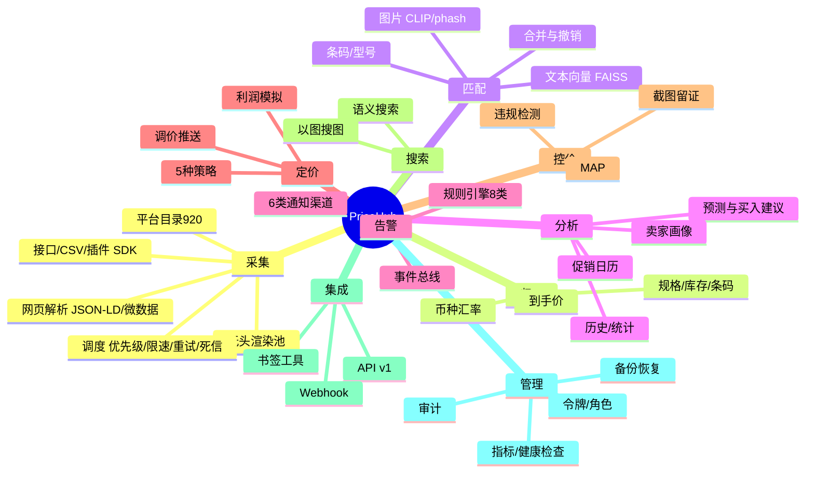

# PriceHub 产品需求文档（PRD）

> 版本：v6 规划稿 ｜ 编写日期：2026-10-21 ｜ 适用代码：v5 之后的重构版本

## 1. 产品定位与价值主张

**一句话定位**：PriceHub 是一款可本地部署、可扩展的全球商品价格全生命周期管理工具，帮助个人买家、电商运营和品牌方以可信、合规的方式“看得到价格、看得懂变化、来得及反应”。

**价值主张**

| 用户痛点 | PriceHub 的回答 |
|---|---|
| 价格散落在几百个平台，人工比价耗时 | 920 个内置平台目录 + 网页/接口/表格/插件多种数据源，统一归一成同一张价格表 |
| 抓到的价格是否可信说不清 | 每个价格点带置信度（采集方式、新鲜度、交叉验证），低置信度明确提示 |
| 价格变了总是后知后觉 | 规则引擎 + 6 类通知渠道，事件总线驱动，分钟级告警 |
| 不同币种、运费、税、优惠混在一起无法比 | 到手价模型（汇率 + 运费 + 税 + 券）统一口径 |
| 品牌方难以发现低价乱价 | MAP 控价、违规检测、带哈希的截图留证、卖家画像 |
| SaaS 工具贵、数据在别人手里 | 单机桌面版免费可用，数据留在本地；同一套代码可升级到 Docker / 集群 |

**差异化**：开源可自托管 + 置信度透明 + 插件化数据源 + 中文场景（国内主流平台、企业微信/飞书/钉钉）。

## 2. 目标用户与画像

| 画像 | 典型身份 | 规模 | 核心诉求 | 付费意愿 |
|---|---|---|---|---|
| P1 精明买家「小林」 | 数码爱好者、代购、企业行政采购 | 10–200 个商品 | 目标价提醒、历史低价、什么时候买 | 低，偏免费 |
| P2 电商运营「王经理」 | 天猫/京东/亚马逊店铺运营 | 500–2 万 SKU | 竞品监控、自动调价、日报 | 中高 |
| P3 品牌渠道「陈总监」 | 品牌方渠道管理/法务 | 200–5000 SKU × 多卖家 | MAP 违规、证据、卖家治理 | 高 |
| P4 数据/IT「赵工」 | 企业数据团队、开发者 | 10 万+ SKU | API、插件、私有化部署、可观测 | 高（企业版） |
| P5 采购分析「刘分析师」 | 供应链/采购 | 1000+ 物料 | 跨国到手价、趋势、报表 | 中 |

## 3. 核心场景与用户旅程

### 3.1 场景清单（按价格生命周期）
发现 → 采集 → 归一/匹配 → 存储/历史 → 分析/预测 → 告警/通知 → 决策（购买/调价/控价）→ 复盘/报表。

### 3.2 关键旅程

**旅程 A：买家等降价（P1）**
1. 在商品页点书签「加入 PriceHub」或粘贴链接 → 快速监控（直接读取，失败自动无头渲染）。
2. 详情页看到历史曲线、到手价、置信度、买入建议（现在买/再等等）。
3. 设定目标价 → 自动生成告警规则 → 降到目标价时企业微信/Telegram 收到消息。

**旅程 B：运营每日调价（P2）**
1. 导入自家 SKU（CSV/接口）→ 系统按条码/型号/文本/图片推荐同款 → 一键合并。
2. 配置定价规则（跟最低价、成本加成、溢价等，含最低毛利和 MAP 约束）→ 利润模拟。
3. 每天 9 点收到日报；调价建议通过 Webhook 推送到 ERP。

**旅程 C：品牌控价（P3）**
1. 录入 MAP 价格 → 系统持续比对 → 发现低于 MAP 的卖家。
2. 一键取证（整页截图 + sha256 + 时间）→ 导出证据清单。
3. 卖家画像查看长期违规率，分级处理。

**旅程 D：企业集成（P4）**
1. 用插件 SDK 写自有数据源插件，放入 plugins 目录即被加载。
2. 通过 /api/v1 + API 令牌接入 BI；/metrics 接入 Prometheus 监控采集成功率。
3. 从单机 SQLite 迁移到 PostgreSQL，Docker Compose 部署。

## 4. 竞品对比（仅列公开可查的信息，价格以官网为准）

| 维度 | Keepa | Prisync | Price2Spy | 卖家精灵 | PriceHub |
|---|---|---|---|---|---|
| 主要对象 | 亚马逊商品价格历史 | 电商竞品价格监控与动态定价 | 价格监控、MAP 监控 | 亚马逊卖家选品/关键词/竞品数据 | 多平台价格全生命周期 |
| 覆盖平台 | 亚马逊多个站点 | 竞品网址 + Google Shopping/亚马逊渠道 | 竞品网站与电商平台 | 亚马逊 | 920 平台目录 + 插件 |
| 定价模式（公开） | API 按“每分钟令牌数”订阅，令牌桶限速，查一个商品 1 令牌 [1] | 按商品数分级：URL 模式 100/1000/5000 商品 99/199/399 美元每月，API 另加 20% [2] | Starter / Basic / Premium 分级，Premium 定制报价 [3] | 订阅制（以官网为准）[4] | 单机免费；团队/企业版建议见第 8 节 |
| 价格历史 | 有（核心能力） | 高档位提供 | 有历史报表 | 有趋势数据 | 有，带置信度 |
| 动态定价 | 无 | 有（Premium 起） | 有调价相关功能 | 无 | 有（5 种策略 + 利润模拟） |
| MAP 监控 | 无 | Platinum 提供 | Basic 起提供 | 无 | 有 + 截图留证 |
| 库存/多规格 | 有亚马逊库存/报价数据 | 有库存监控、变体跟踪 | 有多规格 | 有 | 有 |
| 私有化部署 | 否 | 否（SaaS） | 否（SaaS） | 否 | 是（桌面 / Docker / 集群） |
| 开放扩展 | API | API | API（Premium） | 插件/接口 | API + 数据源插件 SDK |

参考：[1] keepa.com/api-docs/plans-tokens.html ［2］prisync.com/compare-plans ［3］price2spy.com/pricing.html ［4］sellersprite.com 官网。表中“无”指公开资料未见该功能，不排除其另有方案。

**结论**：PriceHub 不正面与 Keepa 拼亚马逊历史数据深度，而以“多平台 + 自托管 + 置信度 + 插件 + 中文生态”切入，在中小团队与品牌方的“可控、可信、便宜”需求上形成差异。

## 5. 功能模块地图



## 6. 信息架构

```
PriceHub
├─ 仪表盘（概览、待处理告警、采集健康）
├─ 商品监控（列表 → 商品详情：曲线/到手价/规格库存/买入建议/跨平台比价/定价建议）
├─ 比价（深度对比、按到手价对比）
├─ 搜索（关键词 / AI 语义 / 以图搜图）
├─ 数据源管理（平台目录、数据源、插件、体检）
├─ 告警与通知（渠道、规则、发送记录）
├─ 同款匹配（建议、合并、撤销）
├─ 控价与卖家（MAP、违规、证据、卖家）
├─ 定价（规则、模拟、推送）
├─ 报表与日历（汇总、导出、定时、促销日历）
└─ 设置与集成（汇率、采集/代理/渲染、令牌、审计、备份、书签、调度队列与死信）
```

## 7. 版本路线图

| 版本 | 目标 | 范围 | 状态 |
|---|---|---|---|
| MVP（v1–v3） | 能采、能看、能比 | 数据源、价格历史、比价、语义搜索、平台目录与体检、置信度 | 已完成 |
| 1.0（v4–v6） | 能告警、能决策、可部署 | 体验优化、规则告警与通知、同款匹配、到手价、MAP、定价引擎、报表、权限审计；v6：领域化重构、插件 SDK、调度器、事件总线、PostgreSQL、FAISS、/api/v1、/metrics、Docker | v6 进行中（本轮） |
| 1.5 | 团队协作 | 多租户与工作区、SSO（OIDC）、任务分派、评论；数据源市场 | 规划 |
| 2.0 | 规模与智能 | 分布式采集节点、TimescaleDB/ClickHouse 时序、pgvector、价格弹性学习、需求预测、官方接口适配器（经授权）、浏览器扩展、移动端 | 规划 |

## 8. 商业模式与版本分级建议

| 版本 | 对象 | 建议能力 | 建议定价思路 |
|---|---|---|---|
| 社区版（开源） | P1、个人开发者 | 单机、≤ 500 商品、全部基础功能、插件 SDK | 免费 |
| 团队版 | P2、P5 | Docker 部署、PostgreSQL、≤ 2 万 SKU、5 席位、定时报表、优先支持 | 按 SKU 档位年付，参考 Prisync 同档位价格的 40–60% |
| 企业版 | P3、P4 | 集群、多租户、SSO、审计导出、SLA、私有插件开发 | 按部署与节点数授权 + 服务费 |
| 增值服务 | 全部 | 经授权的官方数据接口代接、同款匹配人工校对、定制插件 | 按次/按量 |

原则：不出售抓取到的第三方数据本身；收费点在软件能力、部署与服务。

## 9. 核心指标

| 类别 | 指标 | 定义 | 目标（1.0） |
|---|---|---|---|
| 北极星 | 每周“被采取行动的价格事件”数 | 告警被查看后用户完成购买/调价/取证的事件数 | 持续增长 |
| 采集 | 采集成功率 | 成功拿到价格的采集任务 / 总任务（按数据源、平台分组，/metrics 暴露） | ≥ 95%（授权/可达源） |
| 采集 | 平台可用率 | 体检“解析成功+可达”平台 / 有网址平台 | v5：509/800 |
| 质量 | 价格准确率 | 抽样人工核对一致的价格点比例 | ≥ 98% |
| 质量 | 高置信度占比 | 置信度 ≥ 0.8 的价格点比例 | ≥ 80% |
| 时效 | 告警及时性 P95 | 价格入库 → 通知送达的耗时 | ≤ 60 秒（不含采集周期） |
| 时效 | 数据新鲜度 | 监控商品最新价格的平均年龄 | ≤ 采集周期 × 1.5 |
| 可靠 | 死信率 | 进入死信队列的任务 / 总任务 | ≤ 1% |
| 体验 | 首次价格出现时间 | 新用户首次看到一条价格的耗时 | ≤ 3 分钟 |

## 10. 风险与合规

| 风险 | 说明 | 对策 |
|---|---|---|
| robots.txt 与服务条款 | 部分平台禁止自动采集 | 采集前读取 robots.txt 并在平台卡片显示；默认只采集公开商品页；条款禁止的平台标注并建议用官方接口 |
| 反爬 | 224 个平台仍拦截 | **明确不做绕过**（不破解验证码、不伪造登录、不盗用会话）；如实标注“反爬拦截”，引导官方接口/授权数据/CSV 导入 |
| 访问压力 | 高频请求影响对方服务 | 按域名限速、指数退避、错峰；默认低频 |
| 个人信息 | 卖家名称、评论可能涉及个人信息（《个人信息保护法》/GDPR） | 只存业务必要字段，不采集买家信息；支持删除与导出；日志脱敏 |
| 数据授权 | 第三方数据的再分发 | 数据仅限用户自用；官方接口数据遵循其许可；不提供数据转售 |
| 证据效力 | MAP 截图可能被质疑 | 记录时间、网址、sha256，支持导出；建议重要证据走公证 |
| 通知外发 | 误发到真实群 | 渠道需显式测试；测试环境只用本地模拟端点 |
| 安全 | 令牌泄露、远程访问 | 令牌哈希存储、角色权限、非本机访问强制鉴权、审计日志 |
